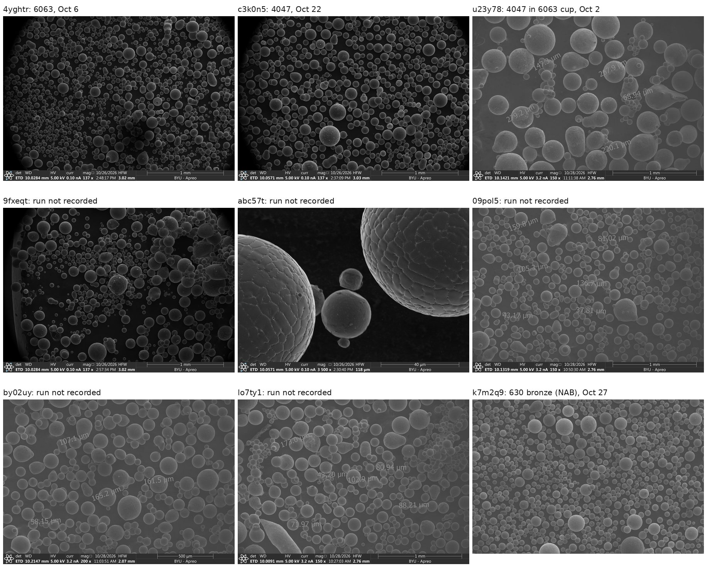

# SEM/EDS of atomized powders

These are powders the lab made on its AMAZEMET rePOWDER ultrasonic atomizer:
- eight aluminium lots, imaged on 2026-10-26 and 10-28;
- the first copper-alloy lot, imaged on 2026-10-27.

All were imaged with SE (ETD) on the BYU Apreo at 5 kV. The lot codes are the bag labels from
[#157](https://github.com/vertical-cloud-lab/digital-alloy-lab/issues/157).

**Missing: the AMAZEMET-atomized AlSi10Mg + Si + Al-wire blend.** Some documents list SEM/EDS of
this blend as done, but none exists on GitHub. See the last section.

## Aluminium lots ([#157](https://github.com/vertical-cloud-lab/digital-alloy-lab/issues/157), posted 2026-10-29)

| Lot | Run (from [#159](https://github.com/vertical-cloud-lab/digital-alloy-lab/issues/159) / #157) | SEM | EDS |
|---|---|---|---|
| `4yghtr` | 2026-10-06 run 1: 180 g Al 6063, CF plate, 1:1 booster, amplitude 50, 840 °C ([#159](https://github.com/vertical-cloud-lab/digital-alloy-lab/issues/159#issuecomment-6353392867)) | 4 (137x, 731x) | spectrum |
| `c3k0n5` | 2026-10-22 run 1: 169 g Al 4047, Mo plate, 1.5:1 booster, 810 °C ([#159](https://github.com/vertical-cloud-lab/digital-alloy-lab/issues/159#issuecomment-6353788099)) | 3 (137x, 1000x) | none |
| `u23y78` | 2026-10-02: lab-atomized Al 4047 powder in a 6063 cup, Mo plate, 1.5:1 booster, amplitude 90, 830 °C ([#157](https://github.com/vertical-cloud-lab/digital-alloy-lab/issues/157#issuecomment-6353391236)) | 2 annotated, downscaled | spectrum |
| `9fxeqt` | not recorded on GitHub | 2 | spectrum |
| `abc57t` | not recorded on GitHub | 4 (137x, 2500x, 3500x) | none |
| `09pol5` | not recorded on GitHub | 2 (150x) | spectrum |
| `by02uy` | not recorded on GitHub | 2 (200x) | spectrum |
| `lo7ty1` | not recorded on GitHub | 2, plus 1 annotated | spectrum |

**What the images show.**
- **Particle sizes.** The particles are mostly spherical, with some satellites and elongated
  drops. The student who imaged them saw groups at about 40-60 µm and 90-110 µm, a few above
  150 µm, and few below 30 µm. That is well above the 15-30 µm target
  ([comment](https://github.com/vertical-cloud-lab/digital-alloy-lab/issues/157#issuecomment-6503073530)).
- **Annotations.** The size labels drawn on the 10-28 images are the student's manual
  measurements, not a particle-size distribution.

**What the EDS is, and isn't.**
- The EDS files are screenshots of EDAX spectra (C, O, Mg, Al, Si peaks).
- There are no quantification tables and no raw spectra. Some automatic peak labels are wrong
  (Br and Tm on the Al peak).
- The original TIFFs and the run sheets for the five unrecorded lots are on the lab's Box,
  according to the student. They are not on GitHub.

The files were downloaded from the #157 attachments on 2026-11-25 and are unmodified. Their
SHA-256 sums are in [`al-lots-issue-157/SHA256SUMS`](al-lots-issue-157/SHA256SUMS), and
[`al-lots-issue-157/FILES.md`](al-lots-issue-157/FILES.md) maps each file to its comment and
attachment URL.

## Copper-alloy lot `k7m2q9`: 630 bronze (UNS C63000, a nickel-aluminium bronze)

- **Run.** 2026-10-27: 1,079.9 g charge, W-dipped CF plate, 1:1.5 booster, amplitude 90,
  1,300 °C ([#219](https://github.com/vertical-cloud-lab/digital-alloy-lab/issues/219)).
- **Imaging.** SEM and EDS were taken the same evening.
- **Where these copies come from.** They are from
  `near-term-submissions/onr-yip/figures-src/img/cu-lot-2026-10-27/` on branch
  `onr-yip-figs-oct27-integrate` ([PR #218](https://github.com/vertical-cloud-lab/digital-alloy-lab/pull/218)).
  Its README gives full provenance.

| File | What it is |
|---|---|
| `nab-c63000-k7m2q9/sem_200x.png` | 200x, HFW 2.07 mm. Data bar removed, resized to 1.150 µm/px |
| `nab-c63000-k7m2q9/sem_2548x_particle.png` | One particle at 2,548x, cropped, 0.0531 µm/px |
| `nab-c63000-k7m2q9/eds_20kV_3p2nA.csv` | **Raw** EDS spectrum, 20 kV, 3.2 nA, EDAX Octane Plus: energy (keV), counts; 4,096 channels. The carbon peak is the mounting tape |

**Size and shape analysis.** A distribution following ISO 13322-1 / 9276, from 9 SEM fields
(5,937 particles), is on branch `claude/issue-225-20261028-0420`, in
`atomizer-runs/2026-10-27-nab-k7m2q9/psd/` ([PR #226](https://github.com/vertical-cloud-lab/digital-alloy-lab/pull/226)).
- Number D50 is 46.9 µm; volume D50 is 103.7 µm.
- The median form factor is 0.987.

**Not here.**
- The 16 source TIFFs are in the private drop
  `sgbaird/agent-staging/for/vertical-cloud-lab/digital-alloy-lab/2026-10-28-nab-c63000-sem-psd/`
  (commit `485dd7b`) and on the lab's Box. They weren't fetched, because this request didn't
  point to that drop.
- The NAB lots from 2026-11-05 (`n05oun`) and 2026-11-10 (`834try`) were sampled
  ([#219](https://github.com/vertical-cloud-lab/digital-alloy-lab/issues/219)). No SEM of them is
  posted.

## Missing: SEM/EDS of the AMAZEMET-atomized blend

`grant-targeting-analysis.md` line 45 and several other documents list "SEM/EDS of precursor and
atomized powders". `edison-trajectories/preliminary-results-roadmap.md` describes the atomized
part as the AlSi10Mg + Si + 1100 Al wire blend that AMAZEMET atomized before the lab had its own
atomizer. **No image, spectrum or report of that product is on GitHub.**

- **The pptx doesn't contain it.** `consolidation-2:genesis-mission-proposal/figures/amazemet-results.pptx`
  holds video frames of the trial, an AMAZEMET schematic, and SEM/EDS of the *starting* Si and
  AlSi10Mg powders (the same images as [`../sem-eds-feedstock/`](../sem-eds-feedstock/)).
- **The powder hadn't come back by 2026-04-15.** On that date
  [byu-vcl#48](https://github.com/vertical-cloud-lab/byu-vcl/issues/48#issuecomment-4254077061)
  was "still waiting on the samples returned from AMAZEMET". On 2026-04-16
  [byu-vcl#16](https://github.com/vertical-cloud-lab/byu-vcl/issues/16#issuecomment-4261062561)
  mentions issues with the powder and wire.
- **Where to look.** Any result would be in e-mail with AMAZEMET or on the lab's Box; check
  whether the samples ever came back. The claims in this repo all copy one list from PR #4's
  body.
