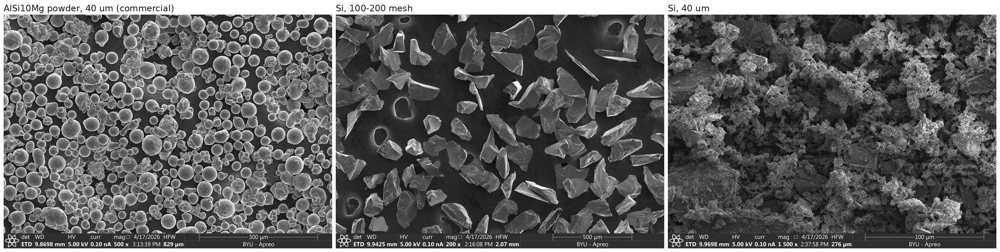
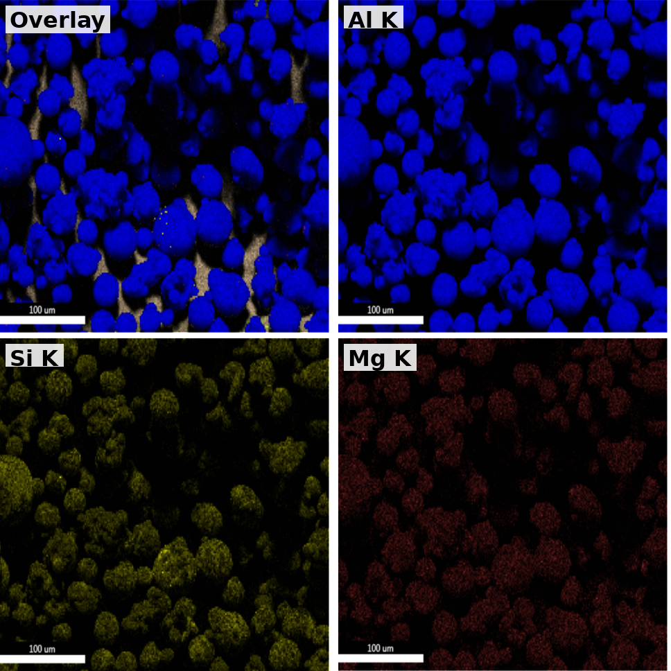

# SEM/EDS of the feedstock powders

These are the three as-received powders the lab blends for atomization (the proposal's
"Si + AlSi10Mg + 1100 Al wire" feedstock):

- commercial AlSi10Mg powder (40 µm),
- Si, 100-200 mesh,
- Si, 40 µm.

The 1100 Al wire has no SEM/EDS. Everything here was imaged at the BYU Microscopy Center on
the Apreo SEM with the EDAX TEAM EDS system. The files were copied unchanged from the
`consolidation-2` branch (see the Files table).

## EDS mapping: whole-field sum spectra

Measured on 2026-04-21 at 15 kV, about 500 s live time, with EDAX eZAF Smart Quant
(standardless). The powder was loose on carbon tape, so carbon and some oxygen come from the
tape and the native oxide. These numbers are **semi-quantitative**.

| Sample (report) | Mag | C | O | Mg | Al | Si | Ca | Fe |
|---|---|---|---|---|---|---|---|---|
| AlSi10Mg 40 µm ([PDF](eds-reports/AlSi10Mg-40-Micron-Mapping.pdf)) | 1000x | 34.41 | 1.44 | 0.88 | 58.22 | 5.05 | | |
| Si 100-200 mesh ([PDF](eds-reports/Si-100-Mapping.pdf)) | 500x | 63.48 | 4.07 | | | 32.37 | | 0.08 |
| Si 40 µm ([PDF](eds-reports/Si-40-Mapping.pdf)) | 2000x | 2.22 | 0.70 | | 1.49 | 94.10 | 0.36 | 1.13 |

Values are wt %.

**AlSi10Mg normalised to the metals.** Leaving out C and O, the AlSi10Mg spectrum gives Al 90.8,
Si 7.9 and Mg 1.4 wt %.
- That puts Si **below** and Mg **above** the alloy's specification (EN AC-43000 / ASTM F3318:
  Si 9-11, Mg 0.20-0.45 wt %).
- The `consolidation-2` README says these values are "within nominal spec". They are not.
- The likeliest cause is standardless EDS of loose, curved particles under a carbon-rich
  background, which skews light-element ratios, rather than an off-spec powder.
- The supplier's certificate or ICP would settle it. The proposal already plans ICP-MS checks
  against EDS.

**Si 40 µm contamination.** This powder shows Fe 1.1, Al 1.5 and Ca 0.4 wt %.
- The element map ([`eds-reports/Si-40-element-overlay.png`](eds-reports/Si-40-element-overlay.png))
  puts Fe, Ca and Al in discrete particles, not spread through the Si.
- That points to foreign particles, for example from milling or handling, rather than to
  alloyed Si.

**Si 100-200 mesh.** This powder is Si with trace Fe (0.08 wt %). The 63 wt % C comes from the
tape between the coarse flakes.

*AlSi10Mg 40 µm: element overlay and Al, Si and Mg K maps, cropped from pages 2-3 of the PDF report.*

## Files

| File | Source on `consolidation-2` | What it is |
|---|---|---|
| `eds-reports/AlSi10Mg-40-Micron-Mapping.pdf` | `figures/eds-reports/` | EDAX mapping report, 9 pages: image, maps, sum spectrum, phase quant |
| `eds-reports/Si-100-Mapping.pdf` | `figures/eds-reports/` | Same, Si 100-200 mesh, 8 pages |
| `eds-reports/Si-40-Mapping.pdf` | `figures/eds-reports/` | Same, Si 40 µm, 10 pages |
| `eds-reports/Si-40-element-overlay.png` | `figures/eds-reports/` | Si 40 µm element overlay map |
| `eds-reports/AlSi10Mg-40-Micron-element-maps.png` | `figures/dag-thumbnails/eds_maps_2x2.png` | 2x2 tile cropped from the AlSi10Mg report |
| `sem/AlSi10Mg_40um_SEM_hires.png`, `sem/Si_100-200mesh_SEM_hires.png`, `sem/Si_40um_SEM_hires.png` | `figures/sem/` | SEM, 2026-04-17, ETD, 5 kV, 500x / 200x / 1500x, 3072 x 2188 px |
| `sem/*_carbon_adhesive_SEM.png`, `sem/*_slurry_SEM.png` | `figures/sem/` | SEM, 2026-04-02: the same powders on carbon tape and dispersed as a slurry, to compare mounting methods. The AlSi10Mg pair is also on `main` in `figures/sem/`. |
| `sem/*_EDS_spectrum.png` | `figures/sem/*_EDS_overlay.png` | Sum spectra, renamed because they are spectra, not overlays |
| `feedstock-sem-overview.jpg` | made here | The three hi-res images side by side, downscaled |

The PDF reports were first posted in
[byu-vcl#49](https://github.com/vertical-cloud-lab/byu-vcl/issues/49#issuecomment-4292356704)
(2026-04-21). `consolidation-2` also has page-by-page PNG renders of the three PDFs in
`figures/eds-reports/`. They aren't copied here because the PDFs hold the same content.
