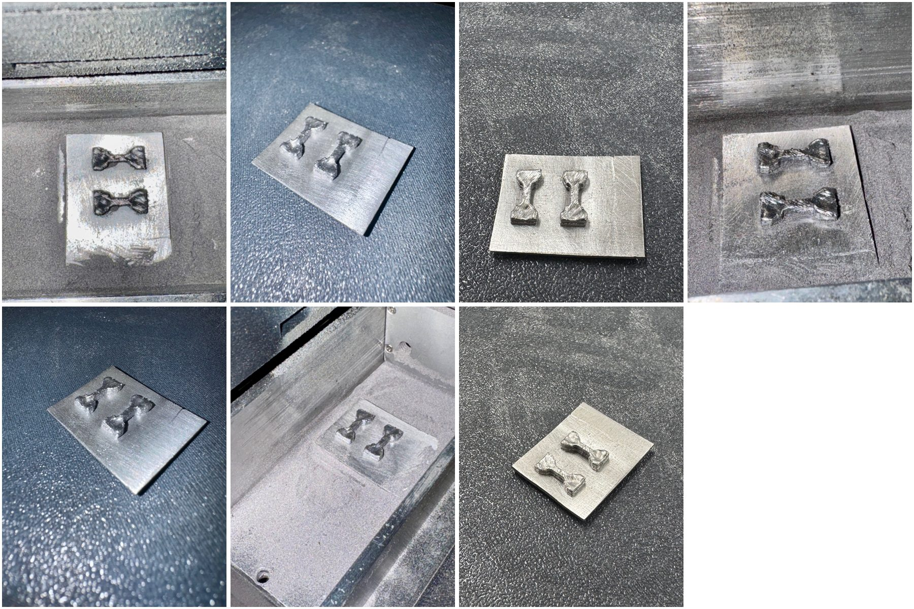

# AlSi10Mg coupons printed by 3D Powder Tech: no tensile data

Source thread: [#133](https://github.com/vertical-cloud-lab/digital-alloy-lab/issues/133).

**This repo has no tensile results for these coupons, and neither does #133.**

## What exists

1. **2026-04-03: powder shipped.**
   - About 40-50 g of the lab's commercial AlSi10Mg powder.
   - Two 26 x 25 x 1 mm 6061 build plates.
   - Destination: 3D Powder Tech's printer at the University of Wisconsin-Madison.
   - Details in the [comment](https://github.com/vertical-cloud-lab/digital-alloy-lab/issues/133#issuecomment-6353366142)
     and a [video of the packing](https://youtube.com/shorts/9ptU6r6MmJY).
2. **2026-04-16: first prints rejected.** 3D Powder Tech was not satisfied with the first
   prints. It attributed the problem to particle shape and said it would make more plates and
   adjust parameters
   ([comment](https://github.com/vertical-cloud-lab/digital-alloy-lab/issues/133#issuecomment-6353366661)).
3. **2026-04-21: photos only.** The last results in the thread are seven photos and a video of
   miniature dog-bone coupons, still on their plates
   ([comment](https://github.com/vertical-cloud-lab/digital-alloy-lab/issues/133#issuecomment-6353366838)).
   The coupons are visibly rough and distorted. No test of them is recorded. The thread then
   moves on to buying a printer.

*The seven 2026-04-21 photos, downscaled into one sheet, with EXIF removed. Credit: 3D Powder Tech.*

The table at [`../README.md`](../README.md) lists this item with no values.

## Where to look next

Any tensile data would be with 3D Powder Tech or in e-mail. #133 says the earlier data and
videos came by e-mail to the student coordinating the print and to the PI.
- Check that e-mail.
- Check whether the coupons came back to BYU.
- If they did, they could be pulled the same way as the Utah coupons.

## Not copied: the spreadability report

The 2026-04-14 attachment in #133, `3D Powder Tech - Birghan Young University.pdf`, is a
**powder-spreadability** report, not tensile data. It covers the lab's AlSi10Mg (MSE Supplies
MP0203, 15-45 µm), spread at 100 and 120 mm/s and layer thicknesses of 40-85 µm.

It isn't copied here for two reasons:
- Its last page restricts it to non-commercial academic use and prohibits redistribution
  without permission.
- Its first and last pages carry a 3D Powder Tech employee's personal contact details.

It is still publicly downloadable from the
[#133 comment](https://github.com/vertical-cloud-lab/digital-alloy-lab/issues/133#issuecomment-6353366541),
because the issue moved to this public repo.
