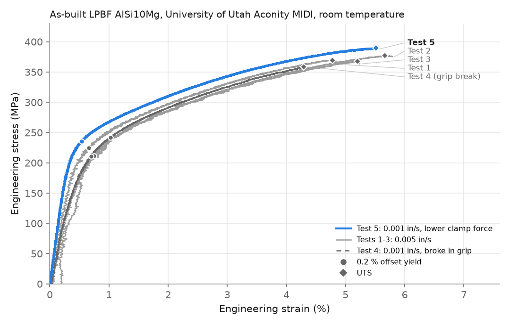
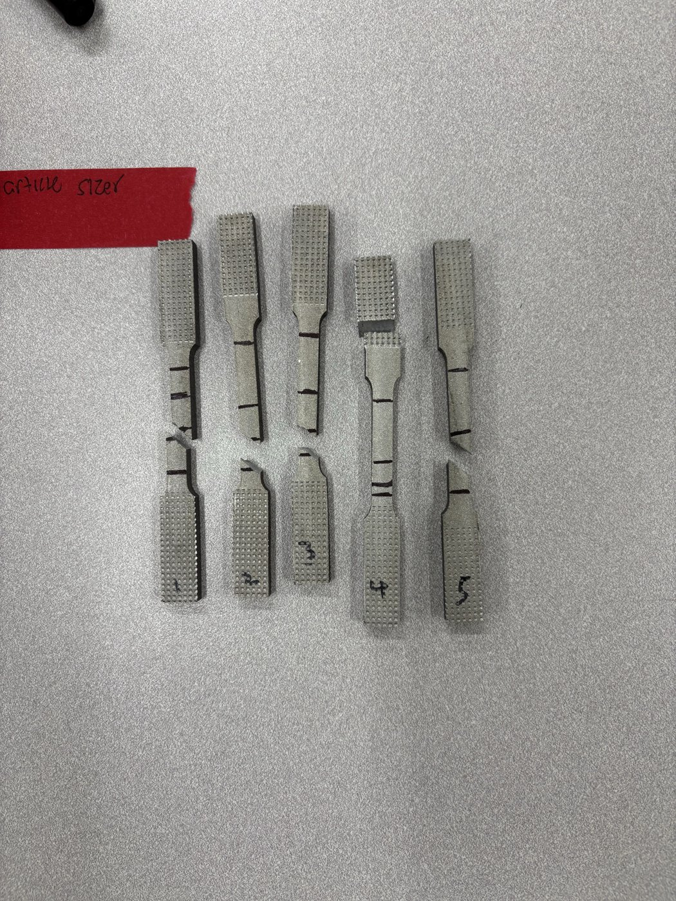
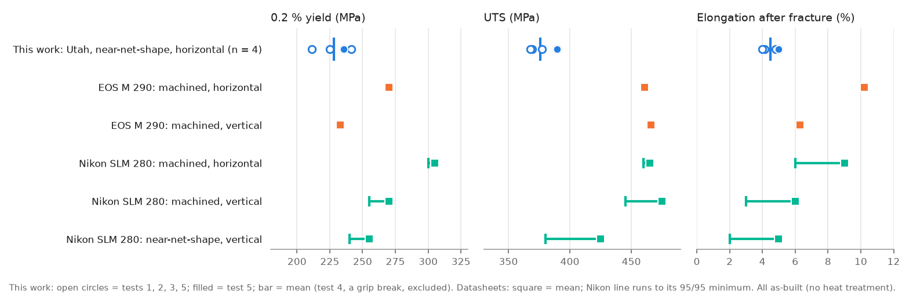

# As-built AlSi10Mg tensile coupons printed at the University of Utah

Source thread: [#138](https://github.com/vertical-cloud-lab/digital-alloy-lab/issues/138).



## What was tested

- **Print.** Ten coupons were printed on 2026-04-23 to 04-27 from the lab's commercial AlSi10Mg
  powder on the Aconity MIDI in the University of Utah's Metal 3D Printing Core Facility. They
  used the facility's own parameters, on a 170 mm aluminium plate. All ten were printed flat
  ([photo](coupons-on-build-plate.jpg)), so the load axis lies in the build plane. The datasheets
  call this orientation "horizontal".
- **Condition.** As built: no heat treatment, and no machining (the surfaces are as printed,
  which the datasheets call "near-net-shape"). The coupons were cut off the plate before
  testing.
- **Geometry.** Flat dog-bone, 100 mm long, 10 mm grip width, 6 x 6 mm reduced section, 32 mm
  parallel length ([drawing](https://github.com/vertical-cloud-lab/digital-alloy-lab/issues/138#issuecomment-6353370602)).
  Each coupon's measured cross-section is in [`specimen-dimensions.csv`](specimen-dimensions.csv).
- **Test.** Five coupons were pulled at room temperature on 2026-04-29 at BYU, on the 100 kip
  load frame because the 20 kip frame was down for repair. The facility gave its error as about
  ±50 lb, which is about ±6 MPa on these coupons.
  - Tests 1-3 ran at 0.005 in/s crosshead speed.
  - Tests 4-5 ran at 0.001 in/s.
  - Test 4 broke in the grip, so it is an invalid test.
  - For test 5 the clamp force was lowered to 1000 lb (MTS run name "1000lbs clamp psi"). The
    student who ran the tests considered test 5 the most representative.
- **Videos.** [Part 1](https://youtu.be/VZc5Wizimk4) and
  [part 2](https://youtu.be/_gsHkQbuqPU); the specimen breaks at
  [59:17](https://youtu.be/_gsHkQbuqPU?t=3557).



## Results compared with the datasheets

All rows are room temperature and as built (no heat treatment). For the Nikon SLM rows, the
95/95 minimum is in brackets.

| Specimens | Yield Rp0.2 (MPa) | UTS (MPa) | Elongation after fracture (%) |
|---|---|---|---|
| Test 1 (0.005 in/s) | 225 | 369 | 4.1 |
| Test 2 (0.005 in/s) | 211 | 377 | 4.8 |
| Test 3 (0.005 in/s) | 241 | 368 | 4.0 |
| Test 4 (0.001 in/s, **broke in grip, excluded**) | *211* | *359* | *3.5* |
| **Test 5** (0.001 in/s, lower clamp force) | **236** | **390** | **5.0** |
| **Mean ± SD, tests 1, 2, 3, 5** | **228 ± 13** | **376 ± 10** | **4.5 ± 0.5** |
| EOS M 290, 30 µm, horizontal, machined | 270 | 461 | 10.2 |
| EOS M 290, 30 µm, vertical, machined | 233 | 466 | 6.3 |
| Nikon SLM 280, 30 µm, horizontal, machined | 305 (300) | 465 (460) | 9 (6) |
| Nikon SLM 280, 30 µm, vertical, machined | 270 (255) | 475 (445) | 6 (3) |
| Nikon SLM 280, 30 µm, vertical, near-net-shape | 255 (240) | 425 (380) | 5 (2) |



**Reading the table**

- **UTS.** The mean UTS is about 81 % of the datasheets' machined horizontal values (461-465
  MPa) and 88 % of Nikon's near-net-shape vertical mean (425 MPa). Test 5 (390 MPa) is just
  above Nikon's near-net-shape minimum (380 MPa).
- **Yield.** The mean yield is about 84 % of EOS horizontal (270 MPa) and below Nikon's near-net-shape
  minimum (240 MPa); test 5 (236 MPa) is just below it.
- **Elongation.** The elongation (4-5 %) is about half the horizontal machined values (9-10 %),
  and close to Nikon's near-net-shape mean (5 %).
- **Why ours are lower.** All three gaps point the same way, and that is expected for a
  first print:
  - The facility's parameters were run on our powder, not on the vendor's qualified
    powder-and-parameter set.
  - The surfaces were not machined.
  - The coupons are small rectangular ones, while the datasheets use round bars (EOS: turned;
    Nikon: DIN 50125 D6x30 machined, C6x30 near-net-shape).
  - Nikon gives no near-net-shape horizontal value, so no row matches our coupons exactly.

Datasheet sources (accessed 2026-11-25, details in [`datasheet-values.csv`](datasheet-values.csv)):
- EOS:
  [Process Data Sheet, EOS Aluminium AlSi10Mg for EOS M 290, 30 µm](https://www.eos.info/metal-solutions/data-sheets/aluminium/pds-eos-aluminium-alsi10mg-eos-m-290-30um)
  (TRL 9). The values are "as manufactured", ISO 6892-1 on machined (turned) samples.
- Nikon SLM Solutions:
  [Material Data Sheet AlSi10Mg, MDS_AlSi10Mg_2025-11.1_EN](https://nikon-slm-solutions.com/wp-content/uploads/2025/11/mds5123.pdf),
  SLM 280 PRECISION parameter set (30 µm, 400 W), "non-heat-treated", DIN EN ISO 6892-1:2020.
  Its 60 and 90 µm sets give lower values.

## How the numbers were computed

[`analyze_tensile.py`](analyze_tensile.py) reads the raw files and writes
[`results.csv`](results.csv) and both figures. Run it with `python analyze_tensile.py`; it needs
numpy, pandas and matplotlib.

- **Stress** is force divided by the measured cross-section.
- **Strain** is the MTS channel `Axial AI1_AOX` (%), the same channel the student's script uses.
  #138 doesn't say which extensometer produced it. The spacing of the marks drawn on each coupon
  (3.4-27.0 mm) is in `specimen-dimensions.csv`.
- **Strain origin.** A line is fitted to the loading curve between 10 % and 35 % of UTS. The
  strain origin is moved to where that line crosses zero stress (toe compensation). This also
  removes the compressive preload the grips put on each coupon before the pull: -129 to -192 MPa
  in tests 1-4, -23 MPa in test 5.
- **Yield** is the 0.2 % offset stress (Rp0.2), using that fitted slope.
- **UTS** is the maximum force divided by the cross-section.
- **Elongation after fracture** is the strain at fracture minus the elastic part (stress at
  fracture divided by the fitted slope). Fracture is the last sample at or above 90 % of the
  maximum force. `results.csv` also has the total extension at fracture, which includes the
  elastic part (4.3-5.8 %).

## Caveats

- **The strain channel is suspect for tests 1-4.** Their fitted elastic slopes are 29-49 GPa,
  well below the ~70 GPa of aluminium, so their strain includes something besides the gauge
  section: grip seating under the higher clamp pressure, or the short mark spacing on tests 1-3.
  - Their yields move by up to 30 MPa when the fit window changes. Test 3, for example, gives
    209-242 MPa for windows from 5-30 % to 20-45 % of UTS.
  - Test 5's slope is 70 GPa, and its yield stays within 235-238 MPa over the same windows. Use
    test 5 when one number is needed.
- **Load accuracy.** The maximum load was about 3,100 lbf, on a 100,000 lbf frame.
- **Crosshead speed.** Both speeds are faster than the strain rate ASTM E8/E8M and ISO 6892-1
  ask for while measuring yield, about 0.00025 /s. Over the 32 mm parallel length, 0.005 in/s
  is about 0.004 /s and 0.001 in/s is about 0.0008 /s. Aluminium is not very rate-sensitive at
  room temperature, but this is not a standard test.
- **Post-fracture samples.** The raw files include the compressive clamping preload at the start
  and a few samples after fracture. The analysis ignores both.

## Files

| File | What it is |
|---|---|
| `raw/test-1_0.005inps.csv` ... `raw/test-5_0.001inps_1000lb-clamp.csv` | The five MTS TestSuite exports attached to [#138](https://github.com/vertical-cloud-lab/digital-alloy-lab/issues/138#issuecomment-6353373011), byte for byte. Only the file names changed (the originals were `AlSi10Mg 1.csv`, `AlSi10Mg 2.csv`, `AlSi10Mg 3.csv`, `AlSi10Mg 0.001inps.csv` and `AlSi10Mg 0.001inps 1000lbs clamp force.csv`). Columns: running time (s), axial displacement (mm), axial force (N), `Axial AI1_AOX` (%). |
| `raw/stress_strain_preliminary.py` | The student's plotting script from [#138](https://github.com/vertical-cloud-lab/digital-alloy-lab/issues/138#issuecomment-6353373360), unmodified (it reads from a local Windows path). |
| `specimen-dimensions.csv` | Width, thickness, area and gauge-mark spacing per coupon, from the table in #138, plus speed, clamp setting and where each coupon broke. |
| `datasheet-values.csv` | The EOS and Nikon SLM values above, with document IDs and URLs. |
| `analyze_tensile.py`, `results.csv` | The analysis, and its per-test output. |
| `stress-strain.png`, `datasheet-comparison.png` | The two figures above. |
| `coupons-on-build-plate.jpg`, `coupons-after-test.jpg` | Photos from #138, downscaled, with EXIF removed. |

SHA-256 of the raw files:

```
840b7e654f12e0d26bbecfd2ce23a4863df59f8acd72f870bff93ddb5ff1f496  raw/test-1_0.005inps.csv
6463e2ec43f1bd413c375017a2fa044b9cbbabe8ef38ab8fdda25d0fa17f8a6d  raw/test-2_0.005inps.csv
1f12c4ced580dd3230b5dbe5feab3c33ccf70f1b0fa64c30d5d8d5f00f09f335  raw/test-3_0.005inps.csv
8cde8b812be1b40bac181c51c49936396b87e8d1d7ea7d0dea2b5c01397ea054  raw/test-4_0.001inps.csv
a5b4b40aa1a430ea0b86f630a62e33a3063048eba3180a258bcf909c0ffbc3ad  raw/test-5_0.001inps_1000lb-clamp.csv
a05548ed196dc0431ac0fb104b8d786aae947be972b724971658819f22857267  raw/stress_strain_preliminary.py
```

The `consolidation-2` branch has another copy of test 5, at
`figures/dag-thumbnails/in-house-tensile-data/AlSi10Mg-0.001inps-1000lbs-clamp-force.csv`. It
has the same 8,838 rows, with the MTS header removed and the values rounded (checked row by
row). That folder also holds the proposal's plotting script and figure.

## Related, not gathered here

- **SEM/EDS of the printed coupons** (not of powder), in #138:
  - [a fracture-surface piece, 2026-04-30](https://github.com/vertical-cloud-lab/digital-alloy-lab/issues/138#issuecomment-6353373994);
  - [a polished section, 2026-05-22](https://github.com/vertical-cloud-lab/digital-alloy-lab/issues/138#issuecomment-6353376021),
    with [optical images](https://github.com/vertical-cloud-lab/digital-alloy-lab/issues/138#issuecomment-6353376087).
- **Five untested coupons** from the same build. #138 mentions intact ones kept in the lab
  ([2026-05-14](https://github.com/vertical-cloud-lab/digital-alloy-lab/issues/138#issuecomment-6353375483)).
  They could serve the high-temperature test that hasn't been run yet
  ([`../high-temperature-tensile/`](../high-temperature-tensile/README.md)).
