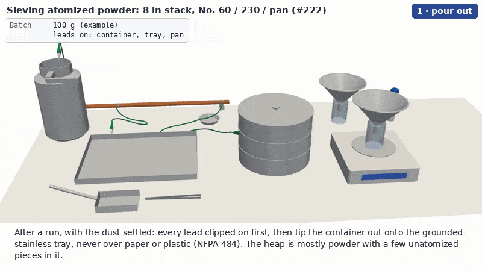

# 3-D animation of the sieving procedure

The procedure in [`docs/sieve-order.md`](../../docs/sieve-order.md), drawn from a CadQuery model and rendered with
PyVista, the same pipeline as #255's [`atomizer-training/viz3d`](../../atomizer-training/viz3d/README.md)
(`scene.py` is a copy of that framework). Parts move along the paths hands would take them; there is no operator
figure. The powder is simulated, not drawn: a DEM pours it, the scoop carries it, the stack sieves it and each sieve
tips it out, and every readout is the mass the simulation holds in that place.



The GIF is 800 × 450 at 5 fps; [`out/sieving.mp4`](out/sieving.mp4) is the same animation at 1280 × 720 and 15 fps.

One animation, `sieving`, in nine sub-steps on the 8 in stack bought on ME Order 13553: tip the container out onto
the grounded tray, tweezers take the pieces to the dish, two scoops onto the No. 60, cover on, sieve (cut open, with a
real-scale inset of the No. 230), then the No. 60 into the dish, the No. 230 through a funnel into the coarse jar,
the pan through a funnel into the print jar on the balance, and lids and label. Three bonding leads stay clipped to
the container, the tray and the pan throughout, to a copper ground bus bar (NFPA 484 / NFPA 77).

## What is simulated

| | How | File |
| --- | --- | --- |
| The powder | Soft-sphere DEM in Numba: linear spring-dashpot contacts (restitution about 0.16), Cundall-Strack tangential springs capped at a friction of 0.62 between parcels (0.3–0.6 on the walls), and no particle rotation, which stands in for rolling resistance: a heap stands instead of creeping flat (a column of parcels slumps to a cone of about 50°, on the steep side). Verlet neighbour lists; a step of about 90 µs. | `dem.py` |
| Its walls | Every part the powder touches (tray, container, scoop, tweezer prongs, sieve frames, cloths, pan, cover, dish, jars, funnels, balance pan) is an analytic wall moving with its part: a thin revolved shell given by its centre line, or thin rectangles. `model.py` builds the drawn solid from the same centre lines and thickness. | `dem.py`, `model.py` |
| The cloths | The DEM's parcels are millimetres, so a cloth can't be resolved in the bench view. A parcel whose size class fits through a cloth (under 63 µm for the No. 230; under 250 µm for the No. 60) crosses it with a probability per second of contact that the shaking raises; larger ones can't. | `dem.py` |
| The No. 230 at real size | A second DEM: 474 Al spheres (D10/D50/D90 = 40/53/70 µm by volume, 74 % of the mass under 63 µm) on a periodic plain-woven patch, 63 µm openings and 44 µm wire, in slow motion (×50), with rotation and rolling resistance. Fines drop through and 63–250 µm roll on the wires. Wedging (blinding) is a rule, since the model has no static friction to hold a particle in an opening: one of 63–67 µm pressed into an opening is locked there. The shaking is exaggerated (a 0.8 g circle, taps on the animation's clock); the docstring has every chosen number. | `zoom.py` |
| The bonding leads | Position-based cables, inextensible, with bending stiffness, that sag, lie on the bench, follow their clip as the part moves and are kept out of the parts (the leads don't collide with each other). Alligator clips on the container, tray and pan; ring lugs on the bus bar. | `cables.py` |
| Nothing passes through anything | Every rendered frame is checked with FCL for parts that interpenetrate (`audit.py`, below). | `audit.py` |

Each DEM sphere in the bench view is a **parcel** standing for a lump of real powder: 2.4 mm for the fines
(< 63 µm), 3.4 mm for 63–250 µm and 4.8 mm for the grit (> 250 µm), 4,253 of them for the 100 g batch, plus seven
unatomized pieces of 5–7 mm at their real size. Grey while the powder is handled, coloured by what it stands for once
the sieving starts: blue < 63 µm (the print fraction), orange 63–250 µm, dark grey > 250 µm.

## Real dimensions, and which ones are not

| Part | Size in the model | Source |
| --- | --- | --- |
| Stack: cover, No. 60 (250 µm), No. 230 (63 µm), pan | 8 in (203.2 mm) frames, 2 in (50.8 mm) deep, so each nested sieve adds 50.8 mm and the stack with its cover is 160 mm tall. The 5/8 in skirt, the 1.2 mm sheet and the rolled rim are the usual 8 in full-height frame, **assumed**: McMaster lists only diameter and depth | McMaster-Carr 7969T19, 7969T38, 7969T46, 7969T21 (ME Order 13553, all 304 stainless, cloth included) |
| Cloth | drawn as a 0.5 mm disc in the bench view | No. 230: 63 µm opening, 44 µm wire (ASTM E11, nominal), drawn at size in the inset |
| rePowder powder container | Ø130 × 202 mm with a Ø90 top tube and a handle | #255's `model.py`: position observed on video, size **assumed**. Not measured yet |
| Tray | stainless, 320 × 240 × 18 mm, 1.2 mm sheet | stand-in |
| Scoop | flat stainless, 50 × 90 mm bowl, 16 mm sides | stand-in |
| Tweezers | 140 mm stainless | stand-in |
| Bonding leads | green 14 AWG leads (Ø3.2 mm) with 45 mm alligator clips; 470, 280 and 560 mm long | NFPA 484 / 77 practice; stand-in lengths |
| Ground bus bar | copper, 540 × 20 × 6 mm on two insulated standoffs, earthed off the back of the bench | stand-in |
| Jars | 100 mL, Ø50 × 80 mm | "smaller jars than the ones from Chem Stores" (#222, 2026-09-29); stand-in size |
| Funnels | Ø146 mm top, Ø14 mm stem, resting on the jar's lip | stand-in |
| Balance | 190 × 210 × 42 mm body, Ø120 mm pan | stand-in for a top-loading balance |
| Powder doser cartridge | Ø25.0 × 100 mm tube with cap | [vertical-cloud-lab/powder-doser PR #170](https://github.com/vertical-cloud-lab/powder-doser/pull/170): the auger tube is Ø25.0 from the STEP files |
| Batch | 100 g, of which one pass (two scoops, about 25 g in the run committed) is sieved | **an example**. DIN 66165 allows 26 cm³ on a 200 mm, 63 µm sieve, about 35–40 g of Al powder, so a 100 g run is three passes or more |
| Split | 75 % under 63 µm, 22 % 63–250 µm, 3 % over 250 µm, by mass | **an example**, after Yankin et al. (2025), whose ultrasonically atomized AlSi12 was about 75 % through 63 µm; not a measurement |

## The collision audit

`steps.py` records every rendered frame's part positions; `audit.py` places each shown part's whole mesh (also for
parts drawn cut open) and the leads' clips, asks FCL which pairs touch, and for each pair that is not built to touch
measures how far the two go into each other (FCL's own depth is unreliable between two triangle meshes). Pairs that
are built to touch (a sieve on the one below, the cover on the No. 60, a funnel on a jar's lip, a jar on the balance,
a clip biting its part) are skipped, and nothing may go below the bench top. The leads report their own deepest point
into any part every frame. The result for the committed render is in [`out/audit.json`](out/audit.json):

- **1090 frames checked, no pair of parts more than 0.3 mm into each other.**
- The leads' deepest point into any part: 0.44 mm for the container's lead (one frame), 0.0 mm for the tray's, 0.02 mm for the pan's.

It caught four real faults on the way, all fixed: the container's bottom swung through the bench and the tray as it
tipped (it is now lifted first); the emptied No. 60 was carried through the coarse funnel and the doser; the cover
grazed the No. 60's rim on its way to the bench; and the base of the container and of the parked cover sat 0.4–0.6 mm
into the bench. It does not check the powder against the parts: the DEM does that every 90 µs, and a parcel at rest
overlaps a wall by a few per cent of its radius (soft contacts), more for a moment when it lands.

## Running

```bash
export PIP_TIMEOUT=600 PIP_RETRIES=2
pip install cadquery pyvista pillow numpy numba scipy trimesh python-fcl   # plus: apt-get install xvfb libgl1-mesa-dri gifsicle ffmpeg
cd sieving/viz3d
python model.py                                                  # builds and caches the meshes, lists the parts
PREVIEW=1 xvfb-run -a -s "-screen 0 1920x1080x24" python steps.py   # last frame of each sub-step -> /tmp/preview_sieving.png
xvfb-run -a -s "-screen 0 1920x1080x24" python steps.py             # out/sieving.gif, out/sieving_still.png, out/mp4/sieving.mp4
python audit.py                                                  # out/audit.json
```

`PREVIEW_EVERY=30` adds every 30th frame to the preview sheet, and `STEPS=3` stops after three sub-steps. The DEM
runs in full in a preview too, since every frame depends on the one before, so a preview takes about 6 minutes and
the full render about 10 on this runner's 4 cores. `out/sieving.json` has the frame range of each sub-step. The MP4
is written to `out/mp4/` (ignored) and copied to `out/sieving.mp4` by hand when it is committed.

## Files

| File | What it is |
| --- | --- |
| `model.py` | The parts as named CadQuery solids with colours, in their assembled places (mm, z up from the bench, the operator at -y), and `colliders()`, the DEM walls built from the same centre lines. `meshes()` tessellates the parts (whole and halved at the stack's axis) and caches them. |
| `dem.py` | The DEM: parcels, contacts, moving analytic walls, cloths. One `advance()` is one frame. |
| `zoom.py` | The real-scale DEM of the No. 230 and its round inset. |
| `cables.py` | The bonding leads, clips and lugs. |
| `steps.py` | The animation: the choreography, the powder's drawing and readouts, the leads and the inset. |
| `scene.py` | #255's Scene framework: grouped actors with parents, eased moves, cutaway blending, leader labels, readouts, captions, GIF and MP4 writers; here also an inset hook and a per-frame record for the audit. |
| `audit.py` | The collision audit. |
