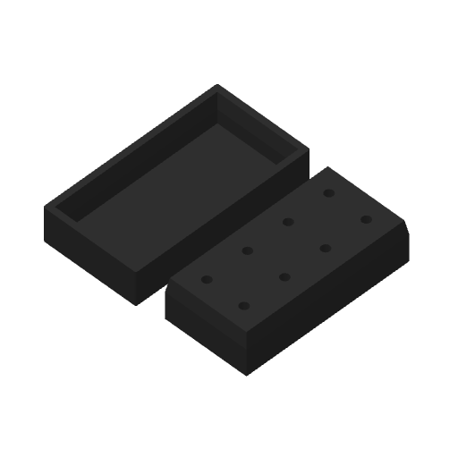

# Stub holder: Top and Bottom on one A1 mini plate

@ronnie-guymon's holder for SEM pin stubs: a block with eight pin holes (Bottom), and a lid
that sits on it (Top). It is designed in the public Onshape document
[*stub holder*](https://cad.onshape.com/documents/bfba88d428bcc884c26d492d/w/2a20dc7be49f7a68f2619dcb/e/85711971e7865921f953f342),
in the Part Studios *Bottom* and *Top*. On 2026-10-30 Ronnie asked on
[PR #174](https://github.com/vertical-cloud-lab/digital-alloy-lab/pull/174) for both parts in
black, together on one A1 mini plate, sliced and stored to print later that day.

- **2026-10-30:** first slice, with the Bottom's holes at Ø3.3 mm.
- **2026-10-30, 21:38 UTC:** Ronnie widened the holes to Ø3.5 mm in Onshape. Nothing else
  changed.
- **2026-11-02:** Ronnie asked for the print. The Bottom was exported again, and the plate was
  re-sliced from it with the same settings. This is the plate stored here now.

**Not printed yet.** This repo's sessions can't send a print, so nothing here has touched the
printer. [Sending it](#sending-it) says who can.



| File | What |
|---|---|
| [`stub_holder_A1mini_blackPLA.gcode.3mf`](stub_holder_A1mini_blackPLA.gcode.3mf) | **The plate to send.** Both parts in black PLA Basic, sliced on 2026-11-02 with the Ø3.5 mm holes. It is a Bambu Studio project with the plate G-code inside |
| [`report.json`](report.json) | What the slice came to |
| [`slice_a1mini.py`](slice_a1mini.py) | Remakes the 3MF from the STLs in about 15 s ([below](#re-running)) |
| [`stub_holder_bottom.stl`](stub_holder_bottom.stl), [`stub_holder_top.stl`](stub_holder_top.stl) | Onshape's STL exports: millimetres, Onshape's frame, "Fine" (0.06 mm chord, 2.5°) |
| [`stub_holder_bottom.step`](stub_holder_bottom.step), [`stub_holder_top.step`](stub_holder_top.step) | Onshape's STEP AP242 exports of the same parts |
| [`onshape/features_bottom.json`](onshape/features_bottom.json), [`onshape/features_top.json`](onshape/features_top.json) | The two feature lists, at microversion `53972c5` (the document as of 2026-10-30 21:38 UTC) |
| [`onshape/export_from_viewer.py`](onshape/export_from_viewer.py) | How the exports were made without an API key ([below](#how-it-was-made)) |

## The parts

| | Bottom | Top |
|---|---|---|
| Size | 70 × 35 × 18 mm | 75 × 40 × 15 mm |
| Volume | 42.3 cm³ | 17.7 cm³ |
| Shape | A solid block with eight Ø3.5 mm holes, 15 mm deep, in a 4 × 2 grid at 17.5 × 16 mm. The top 6 mm of the sides taper in at 10° | A lid: a 3 mm roof over a 12 mm pocket. The last 6 mm of the pocket flares out at 10°, to match the Bottom's taper |

Sketch 3 of the Bottom draws a Ø12.7 mm (½ in) circle around each hole, the size of a
standard stub head. Both STLs are single watertight solids. 0.7 mm fillets round the edges
that lie on the bed, and the Top's four outside corners.

**How the lid fits.** As designed, the two 10° faces meet over 5.6 mm. The lid's rim then
sits 0.4 mm above where the Bottom's taper starts, with 6.4 mm of room for the stub heads
between the Bottom's top face and the lid's roof. Print error only moves the lid up or down:
every 0.1 mm of extra width, summed over both sides, lifts it about 0.3 mm. The hole change
did not touch any of this.

## Print settings

- **Printer and material:** A1 mini with a 0.4 mm nozzle and the Textured PEI Plate. Bambu
  PLA Basic, black, which was in AMS slot A3 on 2026-10-08.
- **Process:** `0.20mm Standard @BBL A1M` with one change, *Auto circle contour-hole
  compensation* on ([why](#circle-compensation-with-the-wider-holes)). The rest is stock: 2
  walls, 15 % grid infill, 5 top and 3 bottom layers, supports off.
- **Orientation:** each part as designed. The Bottom stands on its base with the holes
  pointing up, and the Top lies on its roof with the pocket open upward. Nothing overhangs,
  so there are no supports.
- **Layout:** both parts centred on X, the Bottom at Y 47.5–82.5 mm and the Top at
  Y 92.5–132.5 mm, 10 mm apart.
- **Slice** (Bambu Studio 02.08.02.61): 90 layers to 18.0 mm, 30.90 g (10.20 m). Bambu's
  estimate is 54 min 4 s, of which 48 min 6 s is printing.
  - Bed 65 °C, nozzle 220 °C.
  - No slicer warnings, no toolpath outside the bed.
  - The only G-code warning is the A1 mini's usual `not_support_traditional_timelapse`, so
    send with timelapse off.

### Circle compensation with the wider holes

The 10-30 slice turned the compensation on because the holes were then Ø3.3 mm, for the
Ø3.2 mm pins of standard stubs. byu-vcl's Bambu notes
([`bambu/studio/README.md`](https://github.com/vertical-cloud-lab/byu-vcl/blob/claude/ot2-lid-camera-mount-20260925/bambu/studio/README.md#the-gui-resets-a-cli-projects-changed-settings))
say holes print 0.2–0.4 mm small without it. This slice keeps it on, as the 10-30 plate had
it. The compensation applies Bambu's own error model for PLA Basic, and at Ø3.5 mm it does
what it did at Ø3.3 mm: it lays the walls around each hole 0.21 mm further out, an aim about
0.4 mm wider.

| Slice | Hole in Onshape | Inner wall's path radius, 10 mm up | Printed hole, if byu-vcl's 0.2–0.4 mm holds |
|---|---|---|---|
| 10-30 plate, compensation on | Ø3.3 mm | 2.46 mm | about Ø3.3–3.5 mm |
| **This plate, compensation on** | Ø3.5 mm | 2.56 mm | about Ø3.5–3.7 mm |
| `--stock`, compensation off | Ø3.5 mm | 2.35 mm | about Ø3.1–3.3 mm |

- **With compensation on, the pins should drop in with about 0.3–0.5 mm of play.** The holes
  are 15 mm deep. As long as a stub's pin is shorter than that, its head rests on the block's
  top face, so the play lets a stub shift sideways by up to about 0.25 mm but not tilt.
- **A stock slice would fit snugly, or be tight.** At the small end of byu-vcl's range, a
  Ø3.1 mm hole is too tight for a Ø3.2 mm pin. A ⅛ in (3.2 mm) drill opens it up.
- **The two differ by little else.** The stock slice uses 0.08 g less and is 39 s shorter.
  Nothing else on the plate is round. To make it, run `slice_a1mini.py --stock`.
- **If the wider holes were meant to replace the compensation,** send the stock slice
  instead.

## Sending it

- **This repo's sessions can't send it.**
  - Only byu-vcl's
    [`claude-print.yml`](https://github.com/vertical-cloud-lab/byu-vcl/blob/main/.github/workflows/claude-print.yml)
    can log in to the lab's Bambu account.
  - It runs when a person comments `@claude-print` in byu-vcl. Then it waits until a member of
    [`bambu-print-approvers`](https://github.com/orgs/vertical-cloud-lab/teams/bambu-print-approvers)
    approves the run.
  - This repo has no such workflow, so `@claude-print` here starts nothing. Its `@claude`
    sessions have no Bambu login and none of the printer's LAN secrets, so they can't read
    the printer's status or camera either.
- **To send it,** comment `@claude-print` in byu-vcl, for example on
  [byu-vcl#257](https://github.com/vertical-cloud-lab/byu-vcl/pull/257), where the cable
  holder's thread started, or in a new issue there. Name the file and the printer: this file, on the branch
  `claude/issue-256-20261005-1631` of `vertical-cloud-lab/digital-alloy-lab` (public), and
  the A1 mini. A person can also open the 3MF in Bambu Studio and press *Print plate*.
- **What the plate needs:**
  - the A1 mini's plate clear (byu-vcl's print run takes its own camera frame and judges this);
  - a 0.4 mm nozzle. The slice is for 0.4 mm only, and byu-vcl's rules say to read the
    installed nozzle off the printer before sending;
  - black PLA Basic loaded, with filament 1 mapped to its AMS slot;
  - the Textured PEI Plate;
  - timelapse off.
- **If Studio re-slices the file, check circle compensation is still on.**
  - byu-vcl's runbook found that the GUI quietly swaps a CLI project's process settings for
    the stock preset with the same name.
  - Here that would turn the compensation off. It is under *Quality → Precision*, with
    *Advanced* on.
  - Everything else in this file is stock, so this is the only setting at risk.
  - A GUI slice with it on should also come to 30.90 g. Its estimate should be a little
    shorter, because the GUI allows faster travel moves than the CLI (see below).

## How it was made

- **Export.**
  - This repo has no Onshape API key. Anonymously, the API returns only the document, its
    element list and the feature lists. It answers 401 to glTF, STL, tessellation and
    translation requests.
  - The link share does include EXPORT, though, and the viewer's own Export dialog works
    without signing in.
    [`onshape/export_from_viewer.py`](onshape/export_from_viewer.py) drives that dialog in
    headless Chrome.
  - 2026-10-30: all four files were exported at 20:15–20:16 UTC, at microversion `6ac051c`.
  - 2026-11-02: all four were exported again at 22:10–22:11 UTC, at microversion `53972c5`.
    The document was last changed at 21:38:07 UTC on 10-30.
  - The Top's new STL was byte-identical to its 10-30 export, and its STEP differed only in
    its time stamp, so the Top's 10-30 files stay. The Bottom's files are the new ones.
- **What changed between the exports.**
  - The only design change in either feature list is the Bottom's Sketch 2: the holes'
    diameter, 3.3 mm to 3.5 mm.
  - Onshape also upgraded the document's FeatureScript (library 3095 to 3112), which adds an
    `asVersion` parameter to every feature and changes no geometry.
  - The Bottom's volume fell by 128.1 mm³. That is what widening eight 15 mm deep holes by
    0.2 mm removes.
- **Slice.**
  - [`slice_a1mini.py`](slice_a1mini.py) is byu-vcl's lid-mount slicer cut down to this
    plate. It uses Bambu Studio's command-line slicer with Bambu's system presets, flattened,
    because the command line follows neither `inherits` nor `include`.
  - On top of the presets it sets the filament colour, the bed type and the circle
    compensation. Each part's position is pinned.
  - It also creates `profiles/BBL/machine_full/Bambu Lab A1 mini.json` in the extracted
    AppImage. That is where the CLI looks for the printer's model id, so
    `slice_info.config` carries `N1`, as the GUI's files do.
  - The thumbnails come from a headless Weston display and an OSMesa shim, the same as
    byu-vcl's.
- **Checked against a GUI slice.** On 10-30 this plate's `project_settings.config` was
  compared key by key with the v3 holder's GUI slice from 2026-10-08
  ([`../atomizer-cable-holder/v3/`](../atomizer-cable-holder/v3/README.md)), which used the
  same presets with no changes. The 11-02 slice uses the same settings. They differ in only
  three ways:
  - circle compensation, which is on here;
  - X, Y and travel acceleration limits of 6,000 mm/s², against the GUI's 20,000, 20,000
    and 9,000. The CLI applies Bambu's "CLI-safe" limits from `cli_config.json` by itself.
    On 10-30, the GUI's limits made the estimate 26 s shorter and changed nothing else;
  - keys that the GUI fills from its device list, or that matter only with more than one
    filament: AMS counts and drying presets, flush volumes, the prime tower's position.
- **The G-code** has the A1 mini's start sequence, with bed levelling, `M620 S0A` and
  `M412 S1`. Its MD5 matches the one stored in the 3MF. In the 11-02 slice, the walls of all
  eight holes run from the layer at 3.2 mm to the top face at 18.0 mm, with the inner wall's
  path at a radius of about 2.56 mm at every height checked (3.2, 10, 14.8 and 17.8 mm).

## Re-running

```bash
# Bambu Studio 02.08.02.61, extracted: see byu-vcl's bambu/studio/README.md for the AppImage and its apt packages
sudo apt-get install weston libosmesa6 gcc     # optional, for the thumbnails
export XDG_RUNTIME_DIR=/tmp/xdg && mkdir -p -m 700 $XDG_RUNTIME_DIR
weston --backend=headless --socket=wayland-bambu --idle-time=0 &
export WAYLAND_DISPLAY=wayland-bambu
python slice_a1mini.py --bambu ~/bambu/squashfs-root           # the stored plate and report.json
python slice_a1mini.py --bambu ~/bambu/squashfs-root --stock   # the same plate without circle compensation
```
