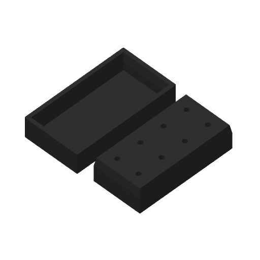

# Stub holder: Top and Bottom on one A1 mini plate

@ronnie-guymon's holder for SEM pin stubs: a block with eight pin holes (Bottom), and a lid
that sits on it (Top). It is designed in the public Onshape document
[*stub holder*](https://cad.onshape.com/documents/bfba88d428bcc884c26d492d/w/2a20dc7be49f7a68f2619dcb/e/85711971e7865921f953f342),
in the Part Studios *Bottom* and *Top*. On 2026-10-30 Ronnie asked on
[PR #174](https://github.com/vertical-cloud-lab/digital-alloy-lab/pull/174) for both parts in
black, together on one A1 mini plate, sliced and stored to print later that day.

**Not printed yet.** Nothing here touched the printer.



| File | What |
|---|---|
| [`stub_holder_A1mini_blackPLA.gcode.3mf`](stub_holder_A1mini_blackPLA.gcode.3mf) | **The plate to send.** Both parts in black PLA Basic, sliced. It is a Bambu Studio project with the plate G-code inside |
| [`report.json`](report.json) | What the slice came to |
| [`slice_a1mini.py`](slice_a1mini.py) | Remakes the 3MF from the STLs in about 15 s ([below](#re-running)) |
| [`stub_holder_bottom.stl`](stub_holder_bottom.stl), [`stub_holder_top.stl`](stub_holder_top.stl) | Onshape's STL exports: millimetres, Onshape's frame, "Fine" (0.06 mm chord, 2.5°) |
| [`stub_holder_bottom.step`](stub_holder_bottom.step), [`stub_holder_top.step`](stub_holder_top.step) | Onshape's STEP AP242 exports of the same parts |
| [`onshape/features_bottom.json`](onshape/features_bottom.json), [`onshape/features_top.json`](onshape/features_top.json) | The two feature lists, at the exports' microversion `6ac051c` |
| [`onshape/export_from_viewer.py`](onshape/export_from_viewer.py) | How the exports were made without an API key ([below](#how-it-was-made)) |

## The parts

| | Bottom | Top |
|---|---|---|
| Size | 70 × 35 × 18 mm | 75 × 40 × 15 mm |
| Volume | 42.4 cm³ | 17.7 cm³ |
| Shape | A solid block with eight Ø3.3 mm holes, 15 mm deep, in a 4 × 2 grid at 17.5 × 16 mm. The top 6 mm of the sides taper in at 10° | A lid: a 3 mm roof over a 12 mm pocket. The last 6 mm of the pocket flares out at 10°, to match the Bottom's taper |

Sketch 3 of the Bottom draws a Ø12.7 mm (½ in) circle around each hole, the size of a
standard stub head. Both STLs are single watertight solids. 0.7 mm fillets round the edges
that lie on the bed, and the Top's four outside corners.

**How the lid fits.** As designed, the two 10° faces meet over 5.6 mm. The lid's rim then
sits 0.4 mm above where the Bottom's taper starts, with 6.4 mm of room for the stub heads
between the Bottom's top face and the lid's roof. Print error only moves the lid up or down:
every 0.1 mm of extra width, summed over both sides, lifts it about 0.3 mm.

## Print settings

- **Printer and material:** A1 mini with a 0.4 mm nozzle and the Textured PEI Plate. Bambu
  PLA Basic, black, which was in AMS slot A3 on 2026-10-08.
- **Process:** `0.20mm Standard @BBL A1M` with one change, *Auto circle contour-hole
  compensation* on ([why](#why-circle-compensation-is-on)). The rest is stock: 2 walls, 15 %
  grid infill, 5 top and 3 bottom layers, supports off.
- **Orientation:** each part as designed. The Bottom stands on its base with the holes
  pointing up, and the Top lies on its roof with the pocket open upward. Nothing overhangs,
  so there are no supports.
- **Layout:** both parts centred on X, the Bottom at Y 47.5–82.5 mm and the Top at
  Y 92.5–132.5 mm, 10 mm apart.
- **Slice** (Bambu Studio 02.08.02.61): 90 layers to 18.0 mm, 30.86 g (10.18 m). Bambu's
  estimate is 53 min 45 s, of which 47 min 46 s is printing.
  - Bed 65 °C, nozzle 220 °C.
  - No slicer warnings, no toolpath outside the bed.
  - The only G-code warning is the A1 mini's usual `not_support_traditional_timelapse`, so
    send with timelapse off.

### Why circle compensation is on

The pins of standard stubs are Ø3.2 mm, and the holes are Ø3.3 mm.
- **A stock slice lays the walls for a hole of exactly Ø3.3 mm.** Printed holes usually come
  out smaller. The compensation applies Bambu's own error model for PLA Basic.
- **The change is small.** At 10 mm up, it lays the walls around each hole 0.21 mm further
  out: the inner wall's path radius is 2.46 mm, against 2.25 mm in the stock slice. That is
  an aim about 0.4 mm wider.
- **byu-vcl puts the error at 0.2–0.4 mm.** Its Bambu notes
  ([`bambu/studio/README.md`](https://github.com/vertical-cloud-lab/byu-vcl/blob/claude/ot2-lid-camera-mount-20260925/bambu/studio/README.md#the-gui-resets-a-cli-projects-changed-settings))
  say holes print 0.2–0.4 mm small with compensation off. At that error a Ø3.3 mm hole comes
  out at 2.9–3.1 mm, too small for a Ø3.2 mm pin.
- **Nothing else on the plate is round,** so nothing else changes. Against the stock slice it
  adds 0.1 g and 15 s.
- **Try a pin in one hole first.** A ⅛ in (3.2 mm) drill opens up a tight hole. For a stock
  slice, run `slice_a1mini.py --stock`.

## Sending it later

- **What the plate needs:**
  - the A1 mini's plate clear;
  - black PLA Basic loaded, with filament 1 mapped to its AMS slot;
  - the Textured PEI Plate;
  - timelapse off.
- **Who can send it:**
  - This repo's `@claude` sessions have no Bambu login. The lab's earlier prints went through
    Bambu Studio on a runner, logged in to the lab's account: route 3 of byu-vcl's
    [Bambu runbook](https://github.com/vertical-cloud-lab/byu-vcl/blob/claude/ot2-lid-camera-mount-20260925/bambu/README.md).
  - A person can also open the 3MF in Bambu Studio and press *Print plate*.
- **If Studio re-slices the file, check circle compensation is still on.**
  - byu-vcl's runbook found that the GUI quietly swaps a CLI project's process settings for
    the stock preset with the same name.
  - Here that would turn the compensation off. It is under *Quality → Precision*, with
    *Advanced* on.
  - Everything else in this file is stock, so this is the only setting at risk.
  - A GUI slice with it on should also come to 30.86 g. Its estimate should be about 26 s
    shorter, because the GUI allows faster travel moves than the CLI (see below).

## How it was made

- **Export.**
  - This repo has no Onshape API key. Anonymously, the API returns only the document, its
    element list and the feature lists. It answers 401 to glTF, STL, tessellation and
    translation requests.
  - The link share does include EXPORT, though, and the viewer's own Export dialog works
    without signing in.
    [`onshape/export_from_viewer.py`](onshape/export_from_viewer.py) drives that dialog in
    headless Chrome.
  - The four files were exported at 20:15–20:16 UTC, at microversion `6ac051c`. The
    document was last changed at 19:17 UTC. A second STL export of the Top at 20:32 was
    byte-identical.
- **Slice.**
  - [`slice_a1mini.py`](slice_a1mini.py) is byu-vcl's lid-mount slicer cut down to this
    plate. It uses Bambu Studio's command-line slicer with Bambu's system presets, flattened,
    because the command line follows neither `inherits` nor `include`.
  - On top of the presets it sets the filament colour, the bed type and the circle
    compensation. Each part's position is pinned.
  - It also creates `profiles/BBL/machine_full/Bambu Lab A1 mini.json` in the extracted
    AppImage. That is where the CLI looks for the printer's model id, so
    `slice_info.config` carries `N1`, as the GUI's files do.
  - The thumbnails come from a headless Weston display and an OSMesa shim, the same as
    byu-vcl's.
- **Checked against a GUI slice.** This file's `project_settings.config` was compared key by
  key with the v3 holder's GUI slice from 2026-10-08
  ([`../atomizer-cable-holder/v3/`](../atomizer-cable-holder/v3/README.md)), which used the
  same presets with no changes. They differ in only three ways:
  - circle compensation, which is on here;
  - X, Y and travel acceleration limits of 6,000 mm/s², against the GUI's 20,000, 20,000
    and 9,000. The CLI applies Bambu's "CLI-safe" limits from `cli_config.json` by itself.
    With the GUI's limits, the estimate is 26 s shorter and nothing else changes;
  - keys that the GUI fills from its device list, or that matter only with more than one
    filament: AMS counts and drying presets, flush volumes, the prime tower's position.
- **The G-code** has the A1 mini's start sequence, with bed levelling, `M620 S0A` and
  `M412 S1`. Drawn at 0.2, 10, 15 and 17.8 mm, the toolpaths look right: solid first layers,
  the eight holes through the Bottom up to its top surface, and the lid's walls.

## Re-running

```bash
# Bambu Studio 02.08.02.61, extracted: see byu-vcl's bambu/studio/README.md for the AppImage and its apt packages
sudo apt-get install weston libosmesa6 gcc     # optional, for the thumbnails
export XDG_RUNTIME_DIR=/tmp/xdg && mkdir -p -m 700 $XDG_RUNTIME_DIR
weston --backend=headless --socket=wayland-bambu --idle-time=0 &
export WAYLAND_DISPLAY=wayland-bambu
python slice_a1mini.py --bambu ~/bambu/squashfs-root           # the stored plate and report.json
python slice_a1mini.py --bambu ~/bambu/squashfs-root --stock   # the same plate without circle compensation
```
