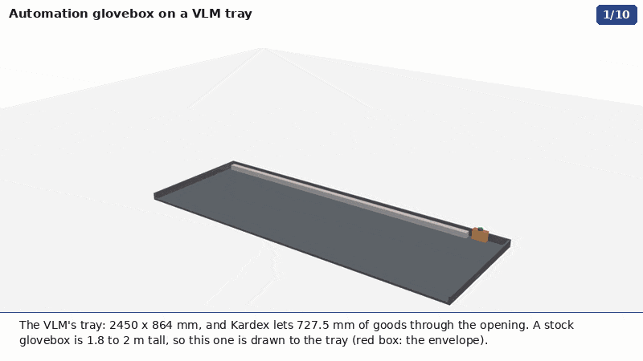
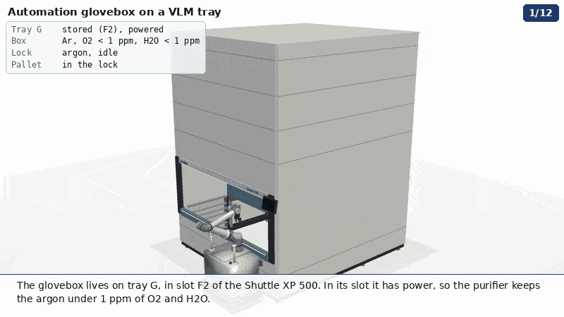
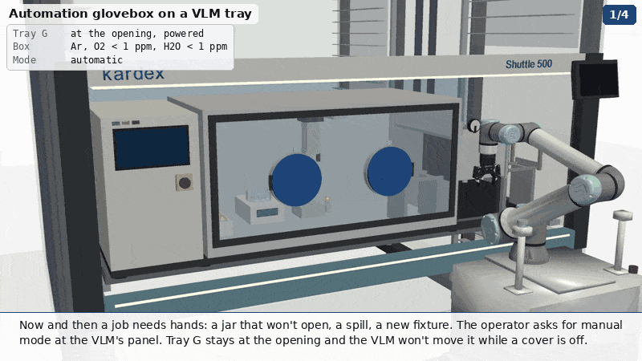
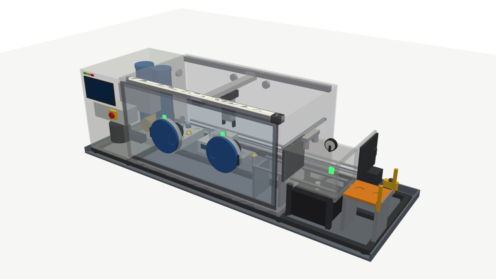
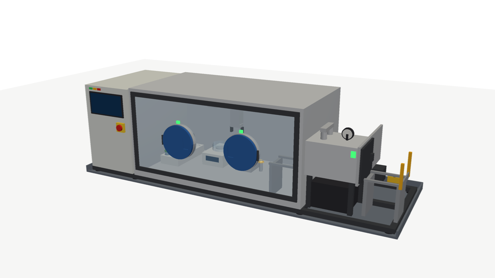
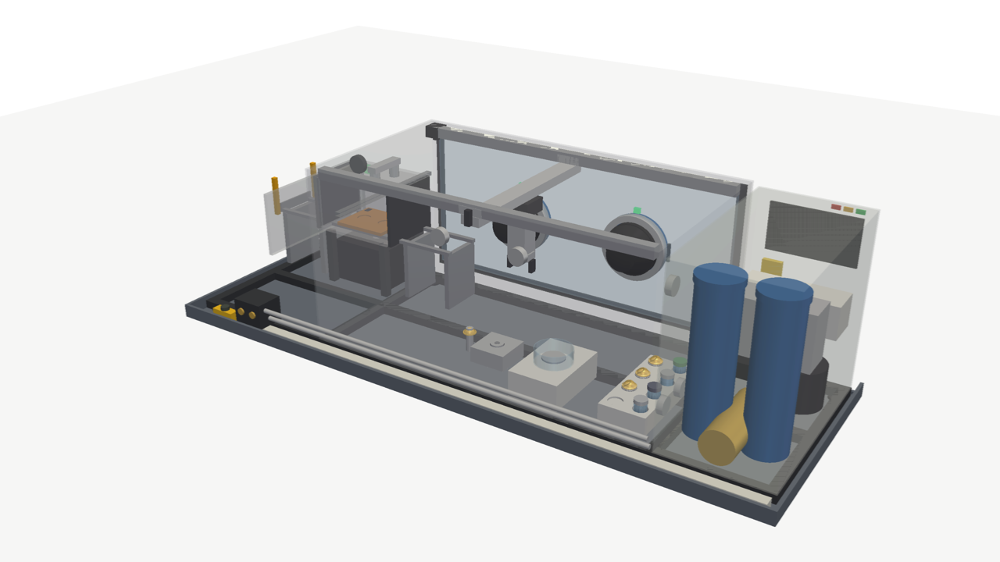
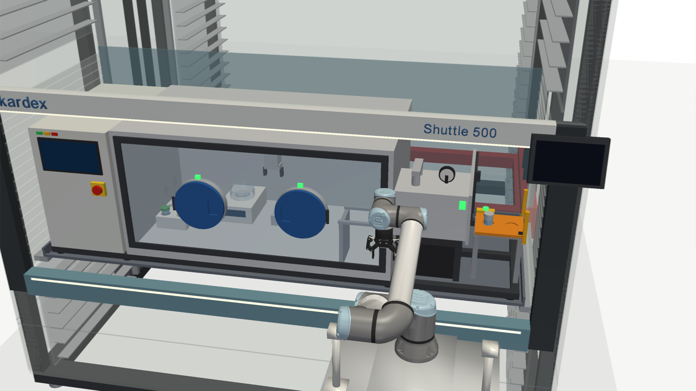

# An automation-first glovebox for a VLM tray

A concept for an inert-gas glovebox built to ride on one tray of the vertical lift module in
[byu-vcl #303](https://github.com/vertical-cloud-lab/byu-vcl/issues/303), a **Kardex Shuttle XP 500** with
2450 × 864 mm trays. Robots load and unload it through an automatic antechamber, whose pallet comes out **to the
side**. The two glove ports stay capped except for the occasional job by hand.

A stock glovebox doesn't fit in the VLM. The Inert PureLab HE 2GB drawn for byu-vcl PR #318 is 1794 mm tall, and
Kardex's order sheet allows **727.5 mm** of product height through the opening, so #318 stands it beside the VLM.
This box is drawn to the tray instead:

| | This design | Kardex limit / tray |
|---|---|---|
| Height over the tray floor | **715 mm** | 727.5 mm (plus 20 mm clearance Kardex requires above it) |
| Footprint | **2400 × 844 mm**, inside the rim, nothing past the tray's front edge | 2426 × 852 mm inside the rim |
| Mass (estimate, [`out/design.json`](out/design.json)) | **about 340 kg** | strong tray 490 kg, medium 360 kg, light 228 kg (byu-vcl #53) |
| Chamber, inside | 1352 × 732 × 667 mm, 660 L | |
| Antechamber | 17.6 L, two sliding gates, a pallet on rails through both | |
| Glove-port centres at the opening | 1227 mm above the floor (good standing height) | presented tray underside at 854 mm |
| Pallet at the opening | 1160 mm above the floor, landing inside the tray | |



## A transfer



1. **Tray G to the opening.** There is no power in transit (byu-vcl #53), so the box rides sealed: valves shut,
   a few mbar over ambient, purifier stopped. The trip takes seconds. A good box leaks well under 0.1 vol% per
   hour, so the transit doesn't matter.
2. **At the opening,** power and the gas dock reconnect. The PLC checks O₂, H₂O and pressure, and that both port
   covers are on.
3. **Out to the side.** The outer gate slides open and the pallet runs out onto a landing at the tray's right end.
   The landing is **inside the tray's footprint**, so nothing crosses the opening's front plane.
4. **The UR10e on its MiR250** (#303's arm) sets a capped jar in the pallet's nest from above. The MiR parks right
   of centre. A light grid on the landing tells the PLC when the arm is clear.
5. **In and cycle.** The pallet runs back, the outer gate shuts, and the lock is evacuated and refilled with argon
   three times. With a 6 m³/h dry pump, one pump-down of 17.6 L to about 1 mbar takes
   V/S · ln(1013/1) ≈ 10.6 s × 6.9 ≈ 75 s ideal, so allow about **2 min per cycle and 6 to 8 min per transfer in**.
   The animation shows it sped up.
6. **Inside.** The inner gate opens and the pallet runs under the gantry. The gantry:
   - weighs the jar on an automation weigh module under a draft ring, with the blower paused while it weighs;
   - stores the jar in the sample hotel;
   - puts the dome on an XRD air-sensitive holder;
   - sets the sealed holder on the pallet.
7. **Out.** Pallet to the lock, inner gate shut. The lock is already argon, so the outer gate opens without a cycle.
   The arm takes the holder (for the XRD on #318's tray D). The pallet goes back, the gate shuts, and the lock is
   cycled once so it waits clean.
8. **Tray G goes home** to its slot, where it has power again and the purifier restarts.

## By hand, now and then



You asked whether it needs gloves at all. I kept two 8 in ports, capped, because jobs come up that the gantry can't
do: a lid that won't open, a spill, a dropped part, a new fixture, servicing the gantry. Without ports, each of those
means opening the box and purging 660 L again, which takes hours. Caps cost little:
- they cut glove permeation, the main O₂/H₂O source in an idle box;
- they protect the gloves;
- the stowed glove sits in its port, out of the gantry's way;
- each cap has a sensor, and the sensors are the main interlock (below).

**Manual mode:**
1. The operator asks for manual mode at the VLM's OPTIC panel or the box's HMI.
2. Tray G stays at the opening. The gantry parks right, with its drives in safe torque off.
3. The covers swing flat against the window.
4. When both covers read closed again, the VLM may move the tray.

Port centres are 500 mm apart, at 1227 mm above the floor at the opening.

## Why the pallet comes out to the side, not the front

| | Side (drawn) | Front drawer (alternative) |
|---|---|---|
| Crosses the opening's front plane | no: the landing is inside the tray | yes, about 300 mm out toward the arm |
| VLM safety integration | Needs only "pallet home" and "gates shut" before a move | The drawer has to be in the VLM's safety chain, next to the light curtain and shutter logic |
| Arm reach | Longer: the MiR parks right of centre (about 620 mm from base to nest, well within the UR10e's 1300 mm) | Shortest |
| Front of the box | Free for the window and the glove ports | The drawer and an operator at the ports compete for the same space |
| Tray width used | About 250 mm for the landing | None, so the chamber could be about 250 mm wider |

The front drawer is the better choice if Kardex can put a drawer-home sensor into the VLM's safety chain and the
chamber needs the width.

## What's in the box



- **Chamber.** 2 mm 304 stainless with folded stiffeners, a full-width polycarbonate window, LED bar, a camera in
  the top front corner, and KF40 feedthroughs at the back.
- **Gantry.** XYZ, hung from the ceiling, with a two-finger gripper. The z axis is a two-stage telescope: a single
  column can't give 300 mm of stroke under a 715 mm roof. Motors run in argon with dry lubrication; drives sit
  outside, through feedthroughs.
- **Stations.**
  - a two-column sample hotel: powder jars, and XRD holders with domes;
  - an automation weigh module (0.1 mg class) under a draft ring;
  - a dome station, where holders are sealed for the XRD on tray D. The Hitachi TM4000PlusII on the same tray
    would need an air-protection holder in the same role.
- **Antechamber.** 8 mm stainless, the only part that sees vacuum. It has two sliding gates that open along +y
  (there's no room to drop them, and lifting them would break the 715 mm height), rails through both gates, a dial
  gauge, valves and a status lamp. The pallet bridges the rail gaps at the gates. It could be driven by a
  two-way-travel slide or a magnetically coupled linear drive.
- **Services bay (left).** A dual-column purifier (Cu catalyst + 13X sieve), so one column can regenerate while the
  box runs on the other. Also the blower, O₂ and H₂O analysers, PLC and drives, a 10 L argon buffer, an HMI, an
  e-stop and status LEDs.
- **Dry scroll pump,** under the antechamber.
- **Gas dock** on the tray's back rim, beside its power socket: argon in and exhaust out through dry-break couplings.
  They are meant to meet a fixed coupling at the slot and at the opening, the way the power does. This needs
  Kardex: see open questions.

| Front | Back, see-through | On tray G at the opening |
|---|---|---|
|  |  |  |

## Interlocks

- **The VLM may move tray G only when** both covers are on, both gates are shut, the pallet is home in the lock, the
  gantry is parked, and the box's PLC reports ready. In practice this is one dry contact from the PLC into the VLM.
- **The outer gate opens only when** tray G is at the opening (signal from the VLM), power and the gas dock are
  connected, and the landing's light grid is clear, or the arm has handed over "clear".
- **Pressure.** The box is held a few mbar over ambient. A relief valve (or bubbler) vents through the dock's
  exhaust, never into the VLM column.
- **O₂ in the room and in the VLM column.** A 660 L argon release in a closed column is an asphyxiation hazard for
  whoever services the VLM, so the column needs an O₂ monitor.

## Safety for the alloy lab's powders

- **Argon, not nitrogen:** Mg reacts with N₂, and Al and Ti do at temperature.
- **Containment:** powders stay in capped jars, inside the box and on the pallet, so a box fault doesn't release them.
- **Grounding:** every metal part inside is bonded to ground.
- **Codes:** NFPA 484 (combustible metals) and NFPA 652 (combustible dust) apply, with a Class D extinguishing
  agent by the VLM.
- **Storage approval:** storing combustible metal powder in a VLM is a question for EHS and the local fire marshal
  before it's a design question. The [procurement notes](../glovebox-options.md#safety-considerations) list the
  same standards.

## Open questions

**For Kardex:**
1. **Load.** 340 kg on a strong tray, with the centre of mass toward the left, where the services bay is. What are
   the tray's distributed-load limits?
2. **Gas dock.** Can a media coupling (Ar in, exhaust out) sit next to the tray's power connector, at the slot and at
   the opening? If not, the box can run from its 10 L buffer between visits and dock only at the opening.
3. **Motion.** Is there a gentle acceleration profile for one tray? It matters for the weigh module and for powders.
4. **Opening.** A robot reaching into the opening is #303's question already. The side landing keeps this box out
   of it.

**For a fabricator, or a custom-box quote** ([`glovebox-options.md`](../glovebox-options.md) covers the
standard-box quotes):
1. **Gates.** Off-the-shelf rectangular gate valves, or custom sliding gates with inflatable seals?
2. **Pallet drive** through two gates.
3. **Window.** Polycarbonate or laminated glass.
4. **Gantry in argon.** Motors, lubrication, and cable-chain outgassing.
5. **Height.** Whether a vendor's low-profile box can meet 715 mm with an automatic antechamber.

## What is drawn and what is estimated

- **The VLM, its tray, the UR10e and the MiR250** are byu-vcl `vertical-lab`'s models. They are fetched at a pinned
  commit (PR #318's head) by [`vertical_lab.py`](vertical_lab.py) and not copied here. The VLM model is built from
  Kardex's published figures and order sheet (see its own sources).
- **The glovebox** ([`model.py`](model.py)) is a concept drawn to the envelope above, not a vendor model.
  - Dimensions are layout choices, checked by `model.py`: it asserts the envelope.
  - Masses come from drawn volumes for fabricated parts, and from typical figures for bought-out items (purifier,
    pump, blower, analysers, PLC), plus 15 %.
  - Purge times are estimated from the pump speed and the antechamber's volume.
- **The weight readout (25.4127 g)** in the animation is illustrative.
- **The arm's moves** are solved with the UR10e's own inverse kinematics, as in #303: straight-line grasps and
  retreats, joint moves between them.

## Files and running

- [`model.py`](model.py): the parametric CadQuery model; it checks the envelope and writes the mass budget.
- [`animate.py`](animate.py): the chapters and stills.
- [`exports/vlm_glovebox.step`](exports/vlm_glovebox.step): the assembly, with names and colours, for Onshape.
- `out/*.gif`: 800 × 450, 10 fps.
- `out/mp4/*.mp4`: 1280 × 720, 15 fps. The three chapters joined: [`out/mp4/glovebox_full.mp4`](out/mp4/glovebox_full.mp4).
- `out/*.png`: stills.
- `out/design.json`: envelope, volumes and the mass budget.

```bash
pip install cadquery pyvista trimesh pycollada pillow numpy scipy      # plus ffmpeg and gifsicle on the PATH
python model.py --step                                                   # envelope check, out/design.json, the STEP
xvfb-run -a python animate.py design transfer manual full                # GIFs and MP4s
xvfb-run -a python animate.py stills                                     # out/*.png
PREVIEW=1 xvfb-run -a python animate.py transfer                         # last frame of each sub-step, to /tmp
```

The first run clones byu-vcl at the pinned commit into `.cache/`. It also downloads the UR10e and Robotiq meshes,
which byu-vcl's `ur_arm.py` fetches from the makers' ROS 2 descriptions.
